# TP3 - Serveur Multi-threads : sockets en mode connecté TCP

*Faculté des Sciences de Sfax - Département d'informatique et des Communications*

*Réalisé par :* Ahmed hamdi

---
# 🔹 Activité 3-1 : Acceptation de plusieurs clients

## 1. Implémentation

### Serveur (Serveur.java)

Le serveur écoute sur le port *1234*. La méthode accept() est bloquante : à chaque connexion, le serveur incrémente numeroClient, affiche l'adresse IP et le port du client avec getRemoteSocketAddress(), puis lance un thread dédié.

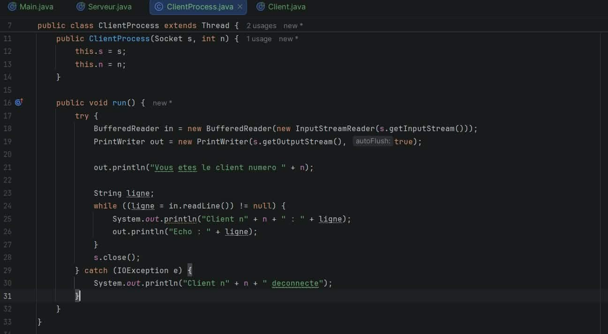

### Thread de traitement (ClientProcess.java)

Chaque thread envoie d'abord au client son numéro d'ordre, puis lit les lignes reçues, les affiche côté serveur et renvoie un écho.

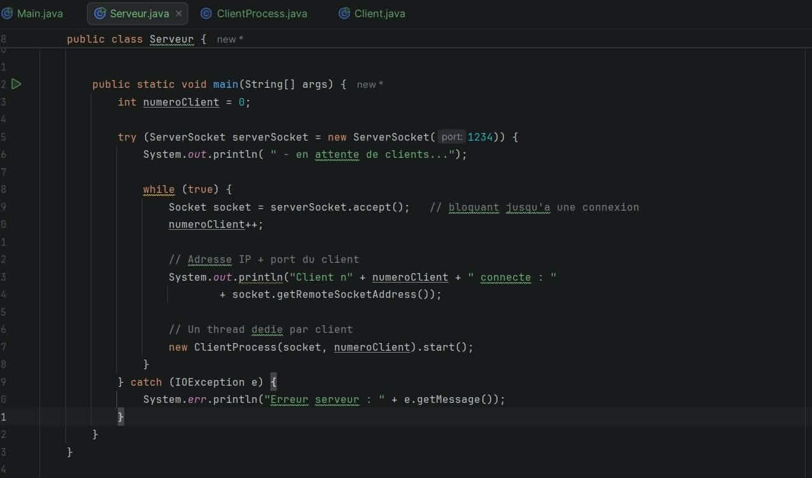

### Client Java (Client.java)

Le client se connecte au serveur grâce à InetAddress et InetSocketAddress. Pour viser un serveur distant, il suffit de remplacer "localhost" par son adresse IP.

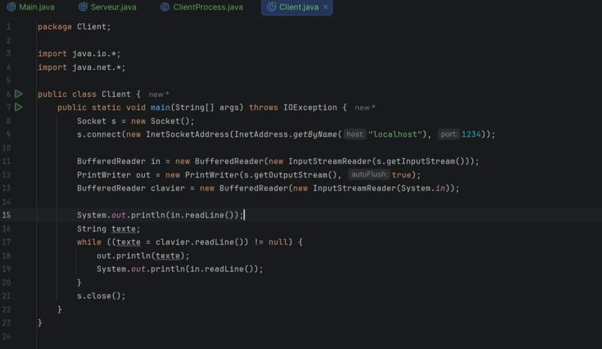

## 2. Tests locaux

### a) Lancement du serveur

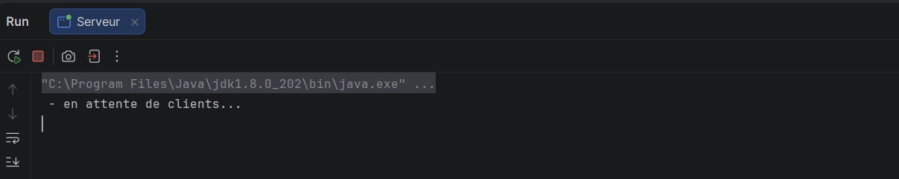

### b) Clients Java

Deux clients Java lancés successivement reçoivent chacun leur numéro d'ordre.

*Client 1*

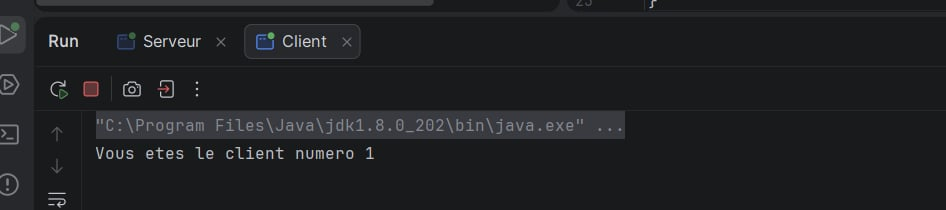

*Client 2*

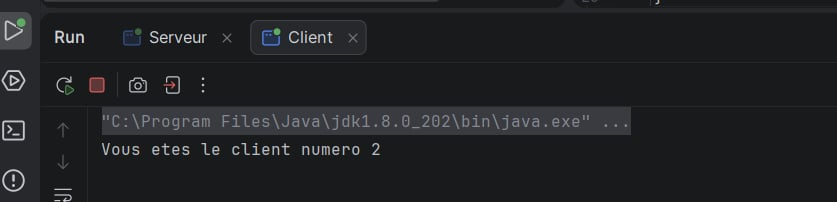

### c) Client Telnet

Au premier essai, la commande telnet localhost 1234 n'était pas reconnue :

Le client Telnet a donc été activé via Panneau de configuration → Programmes → Activer ou désactiver des fonctionnalités Windows → Client Telnet :

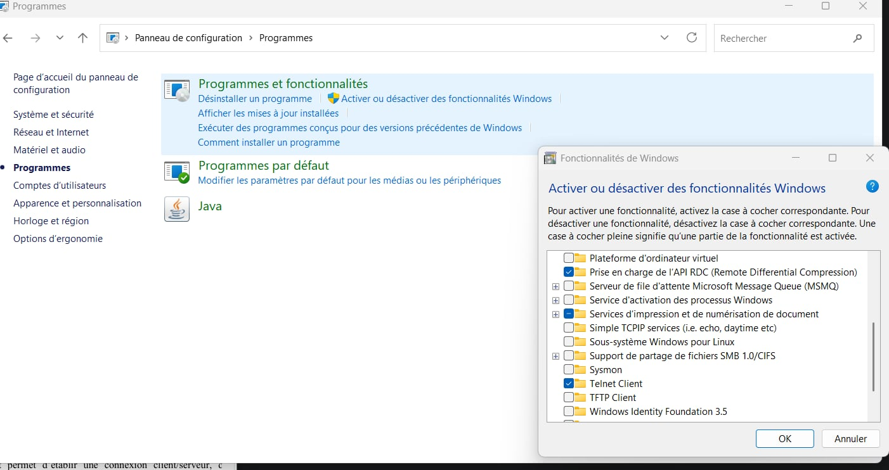

Après activation, la connexion fonctionne : le serveur attribue le numéro 3 au client Telnet.

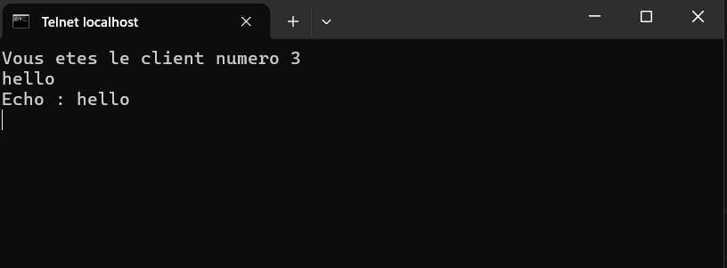

### d) Console du serveur

La console du serveur affiche l'adresse IP, le port et le numéro d'ordre de chaque client :

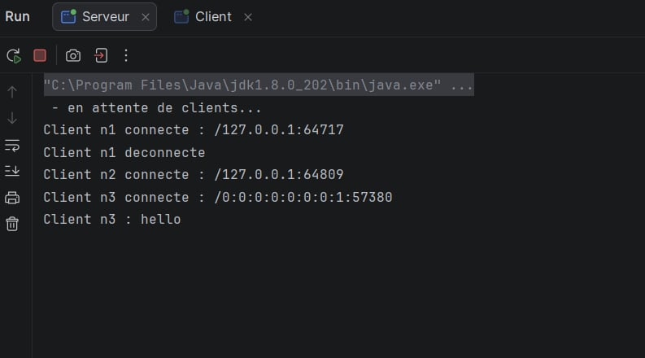

- Client n1 (client Java, /127.0.0.1:64717) s'est connecté puis déconnecté.
- Client n2 (client Java, /127.0.0.1:64809) s'est connecté.
- Client n3 (Telnet, /0:0:0:0:0:0:0:1:57380) s'est connecté en *IPv6* (::1), car Telnet résout localhost en IPv6.
- Le message hello du client n3 est bien affiché côté serveur.

---

# 🔹 Activité 3-2 : Amélioration de l'application calculatrice

## 1. Implémentation

La communication se fait *par objets* (ObjectOutputStream / ObjectInputStream).

### Classe Operation (package common)

Objet sérialisable (implements Serializable) transporté entre le client et le serveur. Il contient les deux opérandes a et b, l'opérateur op et le resultat.

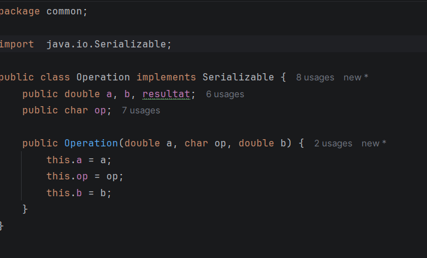

### Serveur (Serveur.java) et compteur global

Le serveur crée un thread ClientProcess pour chaque client. Le *compteur global* est une variable static partagée entre tous les threads. Il est incrémenté dans une méthode synchronized, ce qui garantit l'accès exclusif à cette ressource critique :

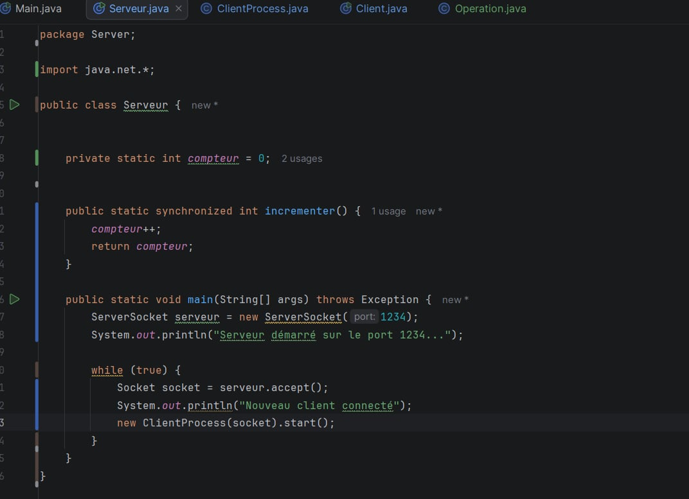

### Thread de traitement (ClientProcess.java)

Le thread lit un objet Operation, calcule le résultat selon l'opérateur (+ - * /), incrémente le compteur global, affiche la nouvelle valeur dans la console du serveur, puis renvoie l'objet au client. L'opérateur q met fin à la session.

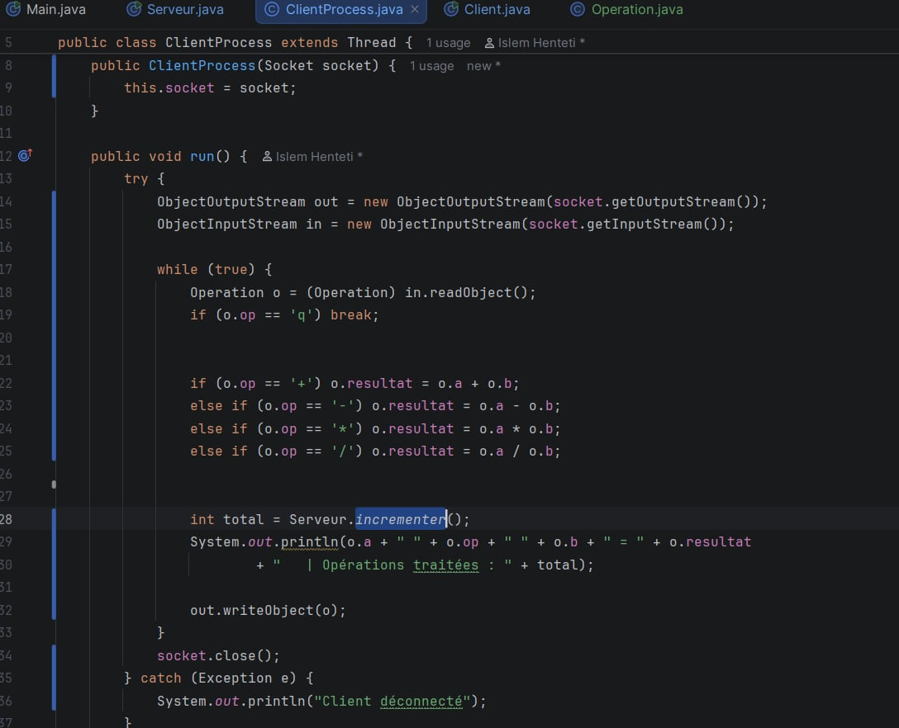

### Client (Client.java)

Le client lit l'opérateur et les deux nombres, envoie un objet Operation, puis affiche le résultat reçu. L'adresse du serveur est passée en argument (args[0]) et vaut localhost par défaut, ce qui permet de tester en réseau local sans modifier le code.

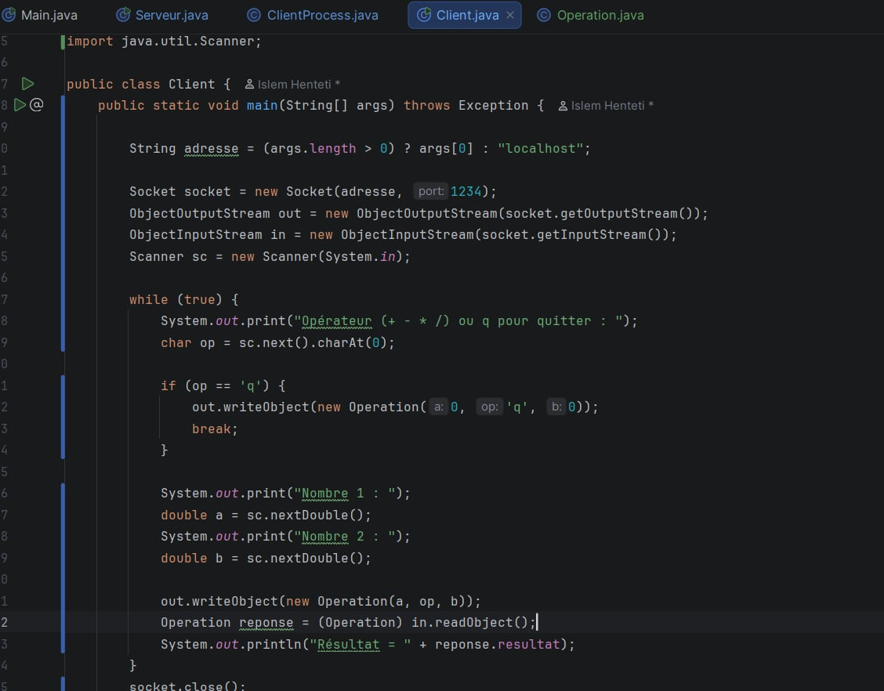

## 2. Tests locaux

### Démarrage du serveur

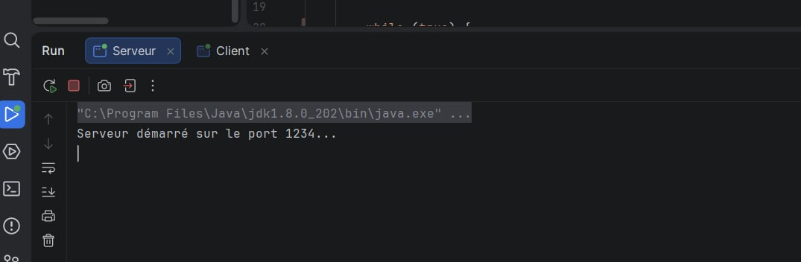

### Client : calcul 9 + 2

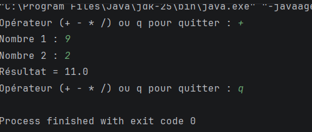

### Console du serveur : compteur global

Le serveur affiche l'opération traitée et la valeur du compteur global :

---
-- *Conclusion :* Ce TP m'a permis de transformer un serveur mono-client en serveur multi-thread : le thread principal accepte les connexions et un thread ClientProcess traite chaque client indépendamment. La calculatrice par objets (Operation) a été testée avec plusieurs clients, et le compteur global, protégé par synchronized, reste cohérent malgré les accès concurrents.
